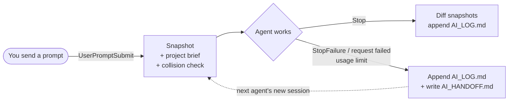

<div align="center">

# 🤝 ai-collab-kit

**Make Claude Code and Codex work like one team — hand off, keep a trail, and pick up where the other left off.**

When one hits its usage limit, the other carries on. Every change is logged automatically. Every new session starts already knowing where the project stands.

[](https://www.python.org/)
[](#-known-limitations)
[](https://code.claude.com/docs/en/hooks)
[](https://learn.chatgpt.com/docs/hooks)
[](#)
[](LICENSE)

[简体中文](README.md) · **English**

</div>

---

## 😩 Sound familiar?

- Claude **hits its usage limit** halfway through a task. You open Codex and explain the whole project again — the background, the progress, which files were touched…
- Two agents take turns on one repo, and a few days later **nobody knows who wrote what**.
- The "don't do X, it breaks Y" lesson you taught Claude **is gone when you switch to Codex**.
- Claude and Codex run **at the same time** and silently overwrite each other's edits.

**ai-collab-kit automates all of this with hooks. It doesn't rely on the model remembering, and you don't have to repeat yourself.** Install once, works in every project.

## ✨ Features

| | Feature | What it does |
|---|---|---|
| 📒 | **Automatic work log** | After every turn, appends to `AI_LOG.md`: who, when, what you asked, which files changed |
| 🧠 | **Context on session start** | The first prompt of every new session gets a project brief: shared memory + handoff + progress + recent log |
| 🔁 | **Auto handoff on failure** | When a turn dies from a usage limit / API error, writes `AI_HANDOFF.md` describing where it stopped and how to resume |
| 🏃 | **One-line takeover** | Tell the other agent "continue the task Claude didn't finish" — it replays the original session via [Turntrail](https://github.com/yagyaanshK/turntrail) |
| 💾 | **Shared long-term memory** | `AI_MEMORY.md` holds decisions, gotchas and your preferences, read and written by both agents |
| 🚧 | **Collision warnings** | If the other agent is working in the same folder right now, the current one is told — including which files it touched |
| 🔍 | **Cross review** | "Ask Codex to review this change" — the other agent gives a read-only second opinion |
| 🔐 | **Secret redaction** | `sk-…` keys, GitHub tokens, `password=…` etc. are masked before anything is logged |
| 🩺 | **Self-check** | `doctor.py` verifies the install, hooks and recent errors, and runs a live self-test |
| ☕ | **No sleep mid-task** | Prevents Windows idle sleep while an agent is answering, releases it afterwards |

## 🎬 What it looks like

**① A new session starts with a project brief** (injected by the hook — invisible to you, visible to the agent):

```text
[ai-collab project brief] Folder: D:\code\my-app

## Shared memory (AI_MEMORY.md)
- 2026-11-15 [codex] Tests need -p no:cacheprovider or they hang on the network drive

## PLAN.md handoff
- Login page done; step 3 left: write the API docs (claude)

## Recent work log (last 3 entries of AI_LOG.md)
### 2026-11-17 14:02 · Codex · `01a1c26e`
- Task: add unit tests for the login endpoint
- Changed: `tests/test_login.py`, `api/login.py`
```

**② The moment Claude runs out of quota, a handoff file appears** — `AI_HANDOFF.md`:

```markdown
# Handoff: Claude ended abnormally
- Reason: rate_limit
- Source: Claude, session `4f1c…`
- Last task: implement login and add error messages
- Files changed this turn: `api/login.py`, `web/Login.vue`

## How to resume
Open Codex in this project and say "continue the task Claude didn't finish".
turntrail import-native --provider claude --session 4f1c…
```

**③ A collision warning:**

```text
[ai-collab warning]
- Codex (session `01a1d130`) is working in this folder (turn started 3 minutes ago, not finished).
  Its task: refactor b.py
  Files changed since then: `b.py` (confirm with the user before editing the same files)
```

> The generated text is in Chinese today (the author's native language). Translating the hook output is on the roadmap — PRs welcome.

## ⚙️ How it works



The core idea is simple: **snapshot the project when you send a prompt, snapshot again when the agent finishes — the difference is what that turn changed.** It doesn't depend on the model remembering to log, or on any tool-specific "file edited" event, so it works the same for Claude and Codex.

To tell whether the other agent is *really* still working, it uses the modification time of that agent's transcript file as a heartbeat — turns you interrupted or windows you closed don't trigger false alarms.

## 🚀 Quick start

**Requires** Python 3.8+ and Git; Node.js 20+ for the takeover feature. Standard library only — zero Python dependencies.

```bash
git clone https://github.com/zzhhzz88/ai-collab-kit.git
cd ai-collab-kit

python install.py --dry-run     # preview, changes nothing
python install.py               # install
```

Then **fully quit and reopen** Claude and Codex (including the tray icons).

Initialize each project once (existing files are never overwritten):

```bash
python init_project.py ~/code/my-project
python init_project.py ~/code/company-repo --private   # new files are ignored locally, never committed
```

Check that everything works:

```bash
python ~/.ai-collab/doctor.py ~/code/my-project
```

> 💡 Fill in the "project overview / common commands" section of `AGENTS.md`. It is the single biggest quality boost you can give the agents.

## 🗣️ Everyday use

| You want to… | Say to the agent |
|---|---|
| Continue after the other one hit its limit | "Continue the task Claude didn't finish in this project" |
| Get a second opinion | To Claude: "ask Codex to review this change"; to Codex: "ask Claude to review" |
| Make it remember something | "Add this to AI_MEMORY.md" |
| Hand off deliberately | "Write the remaining steps into the handoff section of PLAN.md" |

## 🛡️ Safety & privacy

- **Runs entirely locally.** The kit itself makes no network requests (Turntrail's handoff path has no telemetry either).
- Every config file is backed up as `*.bak-ai-collab-<time>` before changes. **Your existing hooks, env vars and rules are preserved**; `--uninstall` removes only what this kit added.
- `AI_LOG.md`, `AI_HANDOFF.md` and `.turntrail/` are ignored locally by default and **never enter git**.
- Prompts and answers are redacted before logging; set `AI_COLLAB_NO_PROMPT=1` to skip logging prompts entirely.
- Hooks fail silently and **never block or interrupt the agent**; errors go to `~/.ai-collab/debug.log`.

## 📦 What's inside

| Path | Purpose |
|---|---|
| `install.py` | Install / uninstall / preview (`--dry-run`, `--uninstall`, `--only claude\|codex`, `--no-turntrail`) |
| `init_project.py` | Per-project setup: `AGENTS.md`, `CLAUDE.md`, `PLAN.md`, `AI_MEMORY.md` |
| `hooks/log_event.py` | Core hook: snapshots, brief, collision warnings, handoff, redaction |
| `hooks/awake_hook.py` | Keep-awake; a crashed holder releases itself after at most 4 hours |
| `hooks/doctor.py` | Self-check |
| `skills/` | `resume-other-agent` (takeover), `ask-codex` / `ask-claude` (cross review) |
| `templates/` | Global collaboration rules, project templates |
| `tests/test_kit.py` | End-to-end tests in a throwaway fake home directory |

<details>
<summary><b>🔧 Environment variables</b></summary>

| Variable | Effect |
|---|---|
| `AI_COLLAB_LOG_ALL=1` | Log turns that changed no files too |
| `AI_COLLAB_NO_PROMPT=1` | Don't record prompt text |
| `AI_COLLAB_NO_AWAKE=1` | Disable keep-awake |
| `AI_COLLAB_NO_BRIEF=1` | Don't inject the project brief |

</details>

## ⚠️ Known limitations

Being upfront about what is and isn't verified:

- ✅ **Tested**: daily use on Windows 11 with Claude Code + Codex; `tests/test_kit.py` covers install/idempotency/uninstall, logging, brief, collisions, handoff, redaction and self-check.
- ❓ **Unverified**: whether Claude's `StopFailure` / Codex's `PostModelRequest` always fire on a real usage limit. If they don't, the other agent's brief still lists the turn that "started but never finished", with its changed files.
- ❓ **Unverified**: macOS / Linux (the code is cross-platform; keep-awake is Windows-only).
- When two agents edit the same folder *simultaneously*, per-file attribution can't be 100% exact; the log flags it. Use git worktrees for exact attribution.
- Turns you interrupt or windows you close send no end signal, so that turn isn't logged.
- A takeover transfers messages, tool calls and file state — **not the model's unrecorded reasoning, and not an interrupted process**.

## 🗺️ Roadmap

- [ ] A unified `ai` command that switches Claude → Codex on usage limits and back after reset
- [ ] Real-time collaboration: agents talking and reviewing each other over MCP
- [ ] More agents (Gemini CLI, Cursor Agent, …)
- [ ] English hook output
- [ ] AI-distilled `AI_MEMORY.md` from past sessions

Issues and PRs welcome! If this saved you from re-explaining your project one more time, **a ⭐ means a lot**.

## 🙏 Acknowledgements

- Takeover is powered by [Turntrail](https://github.com/yagyaanshK/turntrail) (MIT, © Yagyaansh Khaneja). This repo does not vendor Turntrail; the installer fetches it from upstream.
- Inspired by [claudex](https://github.com/karankumar24/claudex), [claude-codex-handoff](https://github.com/OpenMOSS/claude-codex-handoff), [cross-agent-memory](https://github.com/VladimirGutuev/cross-agent-memory), [claude_memory_bank](https://github.com/TranThanh96/claude_memory_bank) and [agentmemory](https://github.com/rohitg00/agentmemory).

## 📄 License

[MIT](LICENSE)
