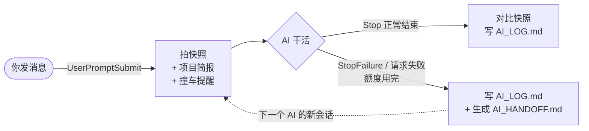

<div align="center">

# 🤝 ai-collab-kit

**让 Claude Code 和 Codex 像一个团队一样，在同一个项目里接力干活。**

一个额度用完，另一个无缝接上。谁改了什么，自动记账。新会话一开口，就知道项目做到哪了。

[](https://www.python.org/)
[](#-已知限制)
[](https://code.claude.com/docs/en/hooks)
[](https://learn.chatgpt.com/docs/hooks)
[](#)
[](LICENSE)

**简体中文** · [English](README.en.md)

</div>

---

## 😩 你是不是也这样

- Claude 写到一半 **额度用完**，打开 Codex，又得从头解释一遍项目背景、做到哪一步、哪些文件动过……
- 两个 AI 轮流改同一个项目，过两天 **完全分不清哪段代码是谁写的**。
- 你在 Claude 里花十分钟讲清楚的“这个坑别踩”，**换到 Codex 就忘了**。
- Claude 和 Codex **同时**开着，结果两个人改了同一个文件，互相覆盖。

**ai-collab-kit 用 hook 把这些都自动化了。不靠 AI 自觉，不用你每次叮嘱。** 装一次，所有项目生效。

## ✨ 功能一览

| | 功能 | 一句话说明 |
|---|---|---|
| 📒 | **自动工作日志** | 每一轮对话结束，自动在 `AI_LOG.md` 记下：谁、什么时候、你让它做什么、改了哪些文件 |
| 🧠 | **新会话自动带上下文** | 新会话第一条消息自动附上「项目简报」：共享记忆 + 交接 + 进度 + 最近日志 |
| 🔁 | **额度用完自动交接** | 因额度/API 错误中断时，自动生成 `AI_HANDOFF.md`，写清楚停在哪、怎么接 |
| 🏃 | **一句话接力** | 对另一个 AI 说「接着做 Claude 没做完的任务」，它用 [Turntrail](https://github.com/yagyaanshK/turntrail) 读取原会话记录继续干 |
| 💾 | **共享长期记忆** | `AI_MEMORY.md` 记决定、踩过的坑、你的偏好，两个 AI 共用共写 |
| 🚧 | **撞车提醒** | 对方正在同一个目录干活时，提醒当前 AI，并列出对方已改动的文件 |
| 🔍 | **互相审查** | 「让 Codex 看看这个改动」—— 对方以只读方式给出第二意见 |
| 🔐 | **密钥自动遮盖** | 写进日志前，`sk-…`、GitHub token、`password=…` 等自动替换 |
| 🩺 | **一键自检** | `doctor.py` 检查安装、hook、最近报错，并真实跑一轮自测 |
| ☕ | **干活时不睡眠** | AI 回答期间阻止 Windows 空闲睡眠，结束自动释放 |

## 🎬 实际效果

**① 新会话一开口，AI 就收到了项目简报**（由 hook 自动注入，你看不到，但 AI 看得到）：

```text
[ai-collab 项目简报] 目录：D:\code\my-app。以下内容由 hook 从项目文件中自动摘录。

## 共享记忆 AI_MEMORY.md
## 踩过的坑
- 2026-11-15 [codex] 测试必须加 -p no:cacheprovider，否则在网络盘上会卡住

## PLAN.md 的交接
- 登录页已完成，还差第 3 步：写 API 文档（claude）

## 最近的工作日志（AI_LOG.md 最后 3 条）
### 2026-11-17 14:02 · Codex · `01a1c26e`
- 任务：给登录接口加单元测试
- 改动：`tests/test_login.py`、`api/login.py`
```

**② Claude 额度用完的那一刻，自动留下交接文件** `AI_HANDOFF.md`：

```markdown
# 交接：Claude 异常结束

- 原因：rate_limit
- 来源：Claude，会话 ID `4f1c…`
- 最后的任务：实现登录功能，并补上错误提示
- 这一轮已改动的文件：`api/login.py`、`web/Login.vue`

## 怎么接手
在这个项目里打开 Codex，说“接着做 Claude 没做完的任务”。
turntrail import-native --provider claude --session 4f1c…
```

**③ 两个 AI 撞车时的提醒：**

```text
[ai-collab 提醒]
- Codex（会话 `01a1d130`）正在这个目录里工作（这一轮开始于 3 分钟前，还没有结束）。
  它当时的任务：重构 b.py
  从那时起变化过的文件：`b.py`（改同一批文件前先和用户确认）
```

**④ 永久的工作日志** `AI_LOG.md`：

```markdown
### 2026-11-04 20:21 · Codex · `x1`
- 任务：给 scene_gen.py 加注释并提交
- 结果：已加注释并提交。
- 改动：`scene_gen.py`
- 同时提交了本轮之前就存在的改动（可能是对方或你自己此前改的）：`main.py`
```

## ⚙️ 工作原理



核心思路很简单：**你发消息时给项目拍一张快照，AI 答完再拍一张，差异就是这一轮的改动。** 不依赖 AI 记得写日志，也不依赖某个工具特有的「编辑文件」事件，所以 Claude 和 Codex 通用。

判断「对方是否还在干活」用的是对方会话记录文件（transcript）的更新时间当心跳 —— 被你中断或关窗口的回合不会被误报成「正在工作」。

## 🚀 快速开始

**需要**：Python 3.8+、Git；接力功能另需 Node.js 20+。纯标准库，零 Python 依赖。

```bash
git clone https://github.com/zzhhzz88/ai-collab-kit.git
cd ai-collab-kit

python install.py --dry-run     # 先预览，不改任何文件
python install.py               # 正式安装
```

然后 **完全退出并重新打开** Claude 和 Codex（托盘图标也要退）。

每个项目初始化一次（已存在的文件不会被覆盖）：

```bash
python init_project.py D:\code\my-project
python init_project.py D:\code\company-repo --private   # 公司仓库：新文件只在本机忽略，不会被提交
```

最后检查一下：

```bash
python ~/.ai-collab/doctor.py D:\code\my-project
```

> 💡 把项目里 `AGENTS.md` 的「项目简介 / 常用命令」改成真实内容 —— 这是让 AI 表现提升最大的一步。

## 🗣️ 日常怎么用

| 想做的事 | 对 AI 说 |
|---|---|
| 一方额度用完，另一方接着做 | 「接着做 Claude 在这个项目里没做完的任务」 |
| 让对方审查 | 对 Claude：「让 Codex 看看这个改动」；对 Codex：「让 Claude 看看」 |
| 记住一件事 | 「把这个记进 AI_MEMORY.md」 |
| 主动交接 | 「把剩余步骤写进 PLAN.md 的交接部分」 |

## 🛡️ 安全与隐私

- **全部本地运行**，本工具自身没有任何网络请求（Turntrail 的交接流程同样无遥测）。
- 改配置前自动备份成 `*.bak-ai-collab-时间`；**你原有的 hook、环境变量、规则全部保留**；`--uninstall` 只删本工具加的内容。
- `AI_LOG.md`、`AI_HANDOFF.md`、`.turntrail/` 默认只在本机忽略，**不会进 git**。
- 日志里的提问和回答会先做密钥脱敏；`AI_COLLAB_NO_PROMPT=1` 可完全不记录提问原文。
- hook 任何异常都静默退出，**绝不会卡住或打断 AI 干活**；错误写进 `~/.ai-collab/debug.log`。

## 📦 包含什么

| 文件 | 作用 |
|---|---|
| `install.py` | 一键安装 / 卸载 / 预览（`--dry-run`、`--uninstall`、`--only claude\|codex`、`--no-turntrail`） |
| `init_project.py` | 项目初始化：`AGENTS.md`、`CLAUDE.md`、`PLAN.md`、`AI_MEMORY.md` |
| `hooks/log_event.py` | 核心 hook：快照留痕、项目简报、撞车提醒、异常交接、密钥脱敏 |
| `hooks/awake_hook.py` | 防睡眠；崩溃时最多保持 4 小时后自动释放 |
| `hooks/doctor.py` | 自检 |
| `skills/` | `resume-other-agent`（接力）、`ask-codex` / `ask-claude`（互相审查） |
| `templates/` | 全局协作约定、项目模板 |
| `tests/test_kit.py` | 端到端测试，在临时的假用户目录里跑，不碰真实配置 |

<details>
<summary><b>🔧 环境变量</b></summary>

| 变量 | 作用 |
|---|---|
| `AI_COLLAB_LOG_ALL=1` | 没改文件的轮次也记录 |
| `AI_COLLAB_NO_PROMPT=1` | 日志里不记录提问原文 |
| `AI_COLLAB_NO_AWAKE=1` | 关闭防睡眠 |
| `AI_COLLAB_NO_BRIEF=1` | 新会话不附项目简报 |

</details>

<details>
<summary><b>🩹 排错</b></summary>

先运行 `python ~/.ai-collab/doctor.py 项目路径`，它会列出问题和修复方法。

- **没出现 `AI_LOG.md`**：看 `~/.ai-collab/debug.log`。常见原因：装完没重启 Claude/Codex；非 git 目录文件太多（建议 `git init`）。
- **Codex 一侧没记录**：较老版本的 Codex 需要在 `~/.codex/config.toml` 加 `[features]` `codex_hooks = true`。
- **`turntrail` 找不到**：重新打开终端；仍不行就把 `npm prefix -g` 显示的目录加入 PATH。
- **互相审查调不动**：终端里要能运行 `codex --version` 和 `claude --version`；用中转站的话 `claude` 命令行需要配好地址和密钥。

</details>

## ⚠️ 已知限制

坦白说清楚，哪些验证过、哪些没有：

- ✅ **已测试**：Windows 11 + Claude Code + Codex 实机使用；`tests/test_kit.py` 覆盖安装/幂等/卸载、留痕、简报、撞车、交接、脱敏、自检。
- ❓ **未验证**：真实额度用完时 Claude `StopFailure` / Codex `PostModelRequest` 是否一定触发。即使不触发，另一个 AI 的新会话简报也会列出「开始了但没正常结束」的那一轮及其改动。
- ❓ **未验证**：macOS / Linux（代码是跨平台写法，防睡眠只在 Windows 生效）。
- 两个 AI **同时**改同一目录时，文件级归属无法 100% 精确，日志会标注「归属不一定准确」。想要精确，用 git worktree 分开。
- 被手动中断、或直接关窗口的回合收不到结束信号，不会留下那一轮的日志。
- 接力能转移对话、工具调用、文件状态；**模型没写进会话的内部思考、被中断的进程无法恢复**。

## 🗺️ 路线图

- [ ] 统一的 `ai` 命令：额度用完自动从 Claude 切到 Codex，重置后切回
- [ ] 实时协作：多个 AI 通过 MCP 实时对话、互相审查
- [ ] 支持更多 agent（Gemini CLI、Cursor Agent 等）
- [ ] 用 AI 从会话中自动提炼 `AI_MEMORY.md`

欢迎提 Issue / PR！如果它帮你省下了重复解释项目的时间，**点个 ⭐ 就是最大的支持**。

## 🙏 致谢

- 接力功能基于 [Turntrail](https://github.com/yagyaanshK/turntrail)（MIT，© Yagyaansh Khaneja）。本仓库不包含 Turntrail 源码，安装时从其上游获取。
- 灵感参考：[claudex](https://github.com/karankumar24/claudex)、[claude-codex-handoff](https://github.com/OpenMOSS/claude-codex-handoff)、[cross-agent-memory](https://github.com/VladimirGutuev/cross-agent-memory)、[claude_memory_bank](https://github.com/TranThanh96/claude_memory_bank)、[agentmemory](https://github.com/rohitg00/agentmemory)。

## 📄 License

[MIT](LICENSE)
